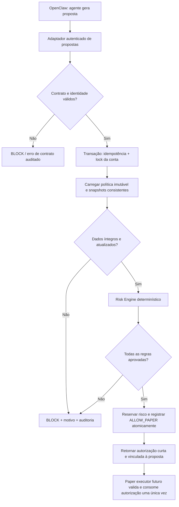

# SPEC — OpenClaw Trading Risk Engine

**ID:** SPEC-TRADING-RISK-001  
**Versão:** 1.0.0  
**Status:** Proposta para implementação (não implantada)  
**Data:** 2026-11-13  
**Stack-alvo:** Node.js 22 LTS+, TypeScript 5.x, PostgreSQL 14, Vitest, Docker (apenas quando necessário)  
**Diretório proposto:** `/opt/openclaw-risk-engine`  
**Idioma dos contratos:** inglês para identificadores técnicos; documentação e logs operacionais em português, quando adequado.

> **Princípio inegociável:** o Risk Engine é um componente determinístico de autorização **exclusivamente para paper trading**. Nenhum output de modelo de IA, nenhuma interface visual e nenhum resultado `ALLOW_PAPER` autoriza uma ordem real. Em caso de dúvida, ausência de dados, indisponibilidade de dependência, falha de persistência ou concorrência não resolvida, a decisão é `BLOCK` ou a operação falha **sem emitir autorização**.

---

## 1. Contexto e decisões de arquitetura

### 1.1 Ambiente existente e confirmado

| Componente | Situação conhecida | Papel no projeto |
|---|---|---|
| `openclaw-trading_openclaw` | 1/1; imagem `ghcr.io/openclaw/openclaw:latest` | Sete agentes analisam mercados e poderão **propor** operações |
| `pixel-agents_web` | 1/1; imagem `ghcr.io/wrpaiva/pixel-agents-trading:2.1.0` | Observabilidade dos agentes; **não** autoriza ordens |
| `pixel-events_receiver` | 1/1; imagem `openclaw-pixel-adapter:0.1.1` | Eventos de atividade; **não** deve ser tratado como barramento confiável para ordens |
| `postgres_postgres` | 1/1; PostgreSQL 14 | Potencial infraestrutura de persistência; requer provisionamento de banco/usuário próprios |
| `redis_redis` | 1/1 | Opcional em fase futura; **não** é requisito de segurança da versão inicial |

No repositório `/opt/pixel-agents-trading`, o diretório `trading-room/` contém apenas `default.json` e `layout.json`, destinados ao layout visual. Não implementar regras de risco nesse projeto ou no receiver de observabilidade.

### 1.2 Decisões

1. **Projeto separado** `openclaw-risk-engine`, de início como biblioteca e aplicação executável por CLI para desenvolvimento e testes; **sem criar automaticamente** stack ou serviço Swarm.
2. **Arquitetura hexagonal moderada**: domínio puro; aplicação orquestra; adaptadores oferecem persistência, fonte de mercado, identidade e, futuramente, HTTP/CLI.
3. **Sem decisões por LLM**: os agentes propõem; o motor valida deterministicamente com política explícita e dados verificados.
4. **Dinheiro e quantidades decimais**: usar biblioteca decimal de precisão arbitrária (por exemplo, `decimal.js`) e persistência `NUMERIC` em PostgreSQL; **proibir `number` JS para decisões financeiras**.
5. **Operação de origem e livro de posições são paper-only**: contas reais são explicitamente rejeitadas; credenciais de corretoras reais não são montadas no Risk Engine.
6. **Fail-closed atômico**: autorização e reserva de capacidade de risco precisam fazer parte da mesma transação de banco antes da emissão de qualquer permissão para execução simulada.
7. **Políticas versionadas e imutáveis**, com hash verificável; alterações criam novas versões, não reescrevem regras antigas.
8. **Contrato estável**: decisão `ALLOW_PAPER` ou `BLOCK`, códigos estruturados de motivo, identificadores, evidências auditáveis.
9. **Regressão ponta a ponta ao final do projeto**, como combinado. Cada etapa ainda exige testes locais mínimos antes de avançar.

### 1.3 Fora do escopo da fase 2

- Negociação real, envio de ordens a exchanges/corretoras, chaves de produção.
- Decisão direcional (comprar/vender), recomendação financeira ou otimização de estratégia.
- Painel de negociação, gráficos financeiros, UI nova, mudanças no Traefik.
- Motor de execução de paper trading completo (fase seguinte), embora contratos de reserva sejam preparados.
- Alta disponibilidade e orquestração distribuída avançadas antes de comprovada necessidade.

---

## 2. Objetivos, invariantes e critérios de sucesso

### 2.1 Objetivos funcionais

- Aceitar propostas tipadas e autenticadas de um dos sete agentes configurados.
- Obter **snapshot consistente** da conta de simulação, posições, ordens/reservas pendentes, P&L do dia, política ativa e dados de mercado.
- Validar tamanho, stop, preço, market data, saldo, risco por operação, exposição, perda diária e restrições por instrumento.
- Decidir `ALLOW_PAPER` ou `BLOCK` com motivos determinísticos e rastreáveis.
- Reservar exposição/capacidade antes de permitir uma ordem simulada e impedir aprovação dupla sob concorrência.
- Retornar resultado idempotente para repetição legítima da mesma proposta.
- Produzir trilha de auditoria durável, inclusive negativas por regra, sem registrar tokens ou dados secretos.

### 2.2 Invariantes de segurança

- **I-01**: Toda ordem simulada aceita pelo futuro executor deve referenciar decisão `ALLOW_PAPER` válida, não expirada, para a proposta exata.
- **I-02**: Nenhuma decisão válida existe sem política versionada, snapshot/inputs verificados e registro persistido.
- **I-03**: Exposição reservada + posições abertas + demais ordens pendentes nunca ultrapassa os limites sob execução concorrente.
- **I-04**: Uma proposta aceita uma única vez não gera duas reservas nem duas execuções.
- **I-05**: Falhas de dependências, concorrência, câmbio, escala numérica e timestamps resultam em **nenhuma autorização**.
- **I-06**: Uma decisão fica vinculada a `accountId`, `agentId`, `proposalId`, `proposalHash`, `policyVersion/hash`, `marketDataAsOf` e `snapshotVersion`.
- **I-07**: `ALLOW_PAPER` não é autorização para operar em contas reais nem por tempo indeterminado.
- **I-08**: Estado de desconexão do receiver visual ou do Pixel Agents não altera por si só decisões do motor; a integridade dos dados de risco é independente.

### 2.3 Métricas de aceite

- Nenhuma autorização em cenários de falha de política, autenticação, market data, DB ou limite.
- Zero aprovações duplicadas para mesma chave em testes de concorrência.
- Idempotência determinística: replay com mesmo payload retorna a decisão original; mesmo identificador com payload alterado é conflito.
- 100% dos cenários obrigatórios da matriz de testes cobertos.
- `npm run typecheck`, `npm run lint` (quando configurado), `npm run test:unit`, `npm run test:integration` executam com sucesso.
- Latência p95 será medida em ambiente de teste; **nenhum SLA numérico será inventado antes da primeira medição**.

---

## 3. Fluxo operacional proposto



**Nota:** o fluxograma explicita um futuro adaptador autenticado. Não usar o plugin de observabilidade `pixel-events` como canal de propostas financeiras, pois ele foi projetado para eventos de atividade e não para autorização de ordens.

### 3.1 Estados de uma proposta

`RECEIVED` → `BLOCKED` ou `AUTHORIZED_PAPER` → `CONSUMED` ou `EXPIRED` / `RELEASED`.

Uma autorização pode reservar risco. O futuro executor deverá consumir a reserva de modo transacional, vinculando-a a um identificador único de ordem simulada. Em falha/cancelamento/expiração, liberar reserva sem duplicar contabilização. Histórico de estados deve ser registrado de forma imutável.

### 3.2 Semântica de falhas

- **Regra de risco violada**: `BLOCK` com código de domínio.
- **Contrato inválido**: erro 400/422 em futuro HTTP, **sem autorização**, evento auditado se identificador confiável estiver disponível.
- **Identidade sem permissão**: erro 401/403, **sem autorização**.
- **Chave idempotente reaproveitada com corpo diferente**: conflito 409, **sem nova autorização**.
- **Banco ou snapshot indisponível**: erro controlado 503 ou resposta bloqueada persistida se houver transação viável; em ambos os casos **sem autorização**. Não alegar auditoria persistida quando o banco estiver indisponível; usar logs estruturados locais como evidência provisória, sem substituí-la.

---

## 4. Contratos de domínio

### 4.1 TradeProposal (v1)

```ts
export type Market = 'CRYPTO' | 'FOREX' | 'METALS';
export type Side = 'BUY' | 'SELL';
export type Environment = 'PAPER';

export interface TradeProposalV1 {
  schemaVersion: 1;
  proposalId: string;           // UUID
  idempotencyKey: string;       // 1..128 caracteres; exclusivo por conta
  accountId: string;            // conta de simulação
  agentId: string;              // allowlist dos sete agentes
  environment: Environment;     // PAPER apenas
  market: Market;
  instrument: string;           // símbolo canônico validado via catálogo
  side: Side;
  orderType: 'MARKET' | 'LIMIT';
  quantity: string;             // decimal positivo, unidade do instrumento
  limitPrice?: string;          // obrigatório para LIMIT
  referencePrice: string;       // referência; NÃO substitui cotação confiável
  stopLossPrice: string;        // obrigatório na política inicial
  createdAt: string;            // ISO-8601 UTC com offset explícito
  expiresAt: string;            // vigência curta; limite na política
  strategyId: string;
  correlationId: string;
}
```

Regras de contrato:

- Identidade do agente deve vir de autenticação do transporte; `agentId` no payload não é prova de identidade.
- `proposalId` UUID e `idempotencyKey` não vazia; `schemaVersion` deve corresponder à versão suportada.
- Strings decimais com escala limitada pelo catálogo do instrumento; rejeitar notação exponencial, `NaN`, `Infinity`, valores negativos/zero quando proibidos e overflow.
- Horário UTC/offset verificável, `createdAt <= now < expiresAt`, validade máxima por política e tolerância de relógio definida.
- `referencePrice` fornecido pelo agente não deve ser usado como preço de mercado definitivo.
- Catálogo de instrumento define tick size, lot size, unidade, moeda de cotação, multiplicador de contrato e regras de exposição; rejeitar instrumentos desconhecidos.
- Conta `PAPER` deve ser validada no lado servidor, não apenas pelo campo declarado.

### 4.2 RiskPolicy (v1)

```ts
export interface RiskPolicyV1 {
  policyId: string;
  version: string;              // imutável, identificador único
  policyHash: string;           // SHA-256 do documento canônico
  status: 'ACTIVE' | 'RETIRED';
  validFrom: string;
  validUntil?: string;
  accountId: string;
  baseCurrency: string;
  maxOrderNotionalBase: string;
  maxGrossExposureBase: string;
  maxInstrumentExposureBase: string;
  maxStrategyExposureBase: string;
  maxDailyLossBase: string;
  maxRiskPerTradeBase: string;
  minAvailableCashBase: string;
  maxMarketDataAgeMs: number;
  maxAccountSnapshotAgeMs: number;
  maxFxRateAgeMs: number;
  maxProposalTtlMs: number;
  maxAuthorizationTtlMs: number;
  mandatoryStopLoss: true;
  allowedMarkets: Market[];
  allowedInstruments: string[];
  enabled: boolean;
}
```

**Valores numéricos:** serão preenchidos por política expressamente aprovada pelo responsável pela operação; **não há valores financeiros padrão**. Uma política incompleta não é habilitável. Política de risco é lida com revisão/hash fixa por avaliação, sem misturar versões durante o processamento.

### 4.3 RiskContext (somente fonte confiável)

```ts
export interface RiskContextV1 {
  accountId: string;
  snapshotVersion: string;
  asOf: string;
  equityBase: string;
  availableCashBase: string;
  realizedDailyPnlBase: string;
  unrealizedPnlBase: string;
  openGrossExposureBase: string;
  pendingReservedExposureBase: string;
  instrumentExposureBase: string;
  strategyExposureBase: string;
  market: {
    instrument: string;
    bid: string;
    ask: string;
    asOf: string;
    source: string;
    sourceSequence?: string;
  };
  conversion?: {
    fromCurrency: string;
    toCurrency: string;
    rate: string;
    asOf: string;
    source: string;
  };
}
```

Contexto deve ser montado por adaptadores autorizados. O Risk Engine deve rejeitar inconsistências, lacunas e snapshots obsoletos. O catálogo de instrumentos e a moeda-base definem como calcular notional, exposição e P&L. Conversão entre moedas exige taxa válida e fresca; **não** supor equivalência USD/BRL ou outras moedas.

### 4.4 RiskDecision (v1)

```ts
export type DecisionStatus = 'ALLOW_PAPER' | 'BLOCK';

export interface RiskViolationV1 {
  code: RiskViolationCode;
  field?: string;
  message: string;              // mensagem de auditoria, não LLM
  observed?: string;
  limit?: string;
}

export interface RiskDecisionV1 {
  schemaVersion: 1;
  decisionId: string;
  proposalId: string;
  accountId: string;
  agentId: string;
  proposalHash: string;
  policyId: string | null;
  policyVersion: string | null;
  policyHash: string | null;
  status: DecisionStatus;
  violations: RiskViolationV1[];
  evaluatedAt: string;
  marketDataAsOf: string | null;
  snapshotVersion: string | null;
  reservationId: string | null; // obrigatório somente se ALLOW_PAPER
  authorizationExpiresAt: string | null;
  correlationId: string;
}
```

**Regra:** `ALLOW_PAPER` exige `violations=[]`, `reservationId`, `authorizationExpiresAt` e uma reserva transacional persistida. `BLOCK` nunca carrega autorização/reserva ativa. Não confiar em decisão enviada por cliente; o executor consulta a decisão persistida no servidor.

### 4.5 Códigos de violação previstos

| Código | Condição |
|---|---|
| `INVALID_PROPOSAL` | Campos, escala, preço ou quantidade inválidos |
| `UNAUTHORIZED_AGENT` | Identidade ou agente não permitido |
| `NON_PAPER_ENVIRONMENT` | Conta ou ambiente não simulados |
| `POLICY_MISSING` | Política aplicável não encontrada |
| `POLICY_INVALID` | Política incompleta, expirada, desativada ou com hash inválido |
| `INSTRUMENT_NOT_ALLOWED` | Instrumento/mercado desconhecido ou proibido |
| `MARKET_DATA_UNAVAILABLE` | Cotação não verificada |
| `MARKET_DATA_STALE` | Cotação fora da janela |
| `FX_RATE_UNAVAILABLE` | Câmbio necessário inexistente/desatualizado |
| `ACCOUNT_SNAPSHOT_STALE` | Saldo/posições não confiáveis |
| `INSUFFICIENT_CASH` | Caixa disponível insuficiente |
| `INVALID_STOP_LOSS` | Stop ausente, inválido ou do lado errado |
| `MAX_ORDER_NOTIONAL` | Valor da ordem ultrapassa limite |
| `MAX_TRADE_RISK` | Perda projetada no stop supera limite |
| `MAX_GROSS_EXPOSURE` | Exposição bruta agregada excedida |
| `MAX_INSTRUMENT_EXPOSURE` | Exposição do instrumento excedida |
| `MAX_STRATEGY_EXPOSURE` | Exposição da estratégia excedida |
| `DAILY_LOSS_LIMIT` | Perda diária atingida/excedida |
| `PROPOSAL_EXPIRED` | Proposta vencida |
| `RISK_CAPACITY_UNAVAILABLE` | Reserva não pôde ser obtida com segurança |
| `INTERNAL_EVALUATION_FAILURE` | Erro inesperado; não autorizar |

Distinguir no transporte falhas de autenticação, idempotência e infraestrutura de violações de domínio; nunca converter indiscriminadamente erro operacional em `ALLOW_PAPER`.

---

## 5. Regras determinísticas (ordem de avaliação)

Cada regra deve retornar `pass` ou violações estruturadas. Avaliações são **puras** sobre entrada e contexto imutáveis; carregamento de dados e gravações ocorrem fora das regras.

| Ordem | Regra | Especificação |
|---:|---|---|
| 1 | Contrato, agente e conta | Validar schema, identidade autenticada, allowlist e conta paper |
| 2 | Política | Exigir versão válida, completa, aplicável e ativa |
| 3 | Freshness | Exigir timestamps confiáveis e idade abaixo de cada limite; relógio e timezone explícitos |
| 4 | Instrumento | Validar catálogo, mercado, precisão, lotes mínimos/ticks e multiplicador |
| 5 | Mercado | Conferir bid/ask e referência, proteger contra preço zero, inválido ou divergência além de limiar definido por política/catálogo |
| 6 | Stop-loss | Para compra, stop abaixo do preço conservador de entrada; para venda, acima; considerar side, spread, tick e direção |
| 7 | Tamanho e notional | Calcular quantidade × preço conservador × multiplicador; converter para moeda-base com fonte validada |
| 8 | Risco por operação | Distância entrada-stop × quantidade × multiplicador + custos/slippage conservadores configurados |
| 9 | Caixa/margem | Aplicar modelo de margem por instrumento e reservas existentes; não presumir que notional equivale a caixa |
| 10 | Exposição | Somar posições abertas + reservas pendentes + nova operação em dimensão global/instrumento/estratégia; contabilizar exposição **bruta**, sem compensar buys e sells indevidamente |
| 11 | Perda diária | Considerar P&L realizado + não realizado conforme política, perdas e reservas; período definido por calendário/mercado da conta, não pelo relógio do navegador |
| 12 | Reserva | Criar reserva única sob lock/serialização; revalidar os dados que podem ter mudado desde a leitura |

**Fórmulas conceituais (não substituir o catálogo):**

- `notionalBase = quantity × conservativeEntryPrice × contractMultiplier × fxRate`.
- `tradeRiskBase = abs(conservativeEntryPrice - stopLossPrice) × quantity × contractMultiplier × fxRate + conservativeFeesAndSlippage`.
- `projectedGrossExposure = openGrossExposure + pendingReservedExposure + incrementalExposure`.
- `remainingDailyLossBudget = maxDailyLoss - currentDailyLossUsage`, segundo a convenção de P&L versionada na política.

### 5.1 Regras de instrumentos e mercados

- **Cripto**: precisão de quantidade, moeda de cotação, regras spot/perp explicitadas; não tratar alavancagem implícita.
- **Forex**: lot size, valor por pip, moeda de lucro e conversão para moeda-base dependem do par e do tamanho do contrato.
- **Ouro/metais**: multiplicador por contrato, unidade (onça/lote) e moeda de cotação explicitamente configurados.
- Não aprovar instrumento sem modelo de produto e cálculo de risco definido; rejeitar derivativos desconhecidos.

### 5.2 Política de perdas e exposição

- Definir explicitamente reset diário por calendário de risco (timezone e horário), e tratamento de mercado 24/7.
- Incluir ordens/reservas pendentes em qualquer cálculo de exposição.
- Adotar modelo conservador para operações `SELL` e/ou short; sem capacidade de margem/short definida, bloquear.
- Evitar aprovação em cascata com contexto de saldo congelado; lock e cálculo dentro da transação ou mecanismos equivalentes de controle otimista com retry limitado.

---

## 6. Projeto de software e padrões

```text
openclaw-risk-engine/
├── README.md
├── SPEC.md
├── package.json
├── package-lock.json
├── tsconfig.json
├── .env.example              # sem credenciais reais
├── src/
│   ├── domain/
│   │   ├── TradeProposal.ts
│   │   ├── RiskPolicy.ts
│   │   ├── RiskContext.ts
│   │   ├── RiskDecision.ts
│   │   ├── RiskViolation.ts
│   │   ├── InstrumentSpec.ts
│   │   └── value-objects/
│   │       ├── DecimalAmount.ts
│   │       ├── Price.ts
│   │       └── UtcInstant.ts
│   ├── application/
│   │   ├── EvaluateTradeRisk.ts
│   │   ├── ReserveRiskCapacity.ts
│   │   ├── ReleaseRiskReservation.ts
│   │   ├── ConsumePaperAuthorization.ts
│   │   └── ports/
│   │       ├── RiskPolicyRepository.ts
│   │       ├── AccountSnapshotRepository.ts
│   │       ├── MarketDataProvider.ts
│   │       ├── InstrumentCatalog.ts
│   │       ├── RiskDecisionRepository.ts
│   │       ├── RiskReservationRepository.ts
│   │       ├── TransactionManager.ts
│   │       ├── AuthenticatedAgentContext.ts
│   │       └── Clock.ts
│   ├── rules/
│   │   ├── RiskRule.ts
│   │   ├── PolicyValidityRule.ts
│   │   ├── MarketFreshnessRule.ts
│   │   ├── StopLossRule.ts
│   │   ├── OrderNotionalRule.ts
│   │   ├── PerTradeRiskRule.ts
│   │   ├── CashAndMarginRule.ts
│   │   ├── ExposureRule.ts
│   │   └── DailyLossRule.ts
│   ├── infrastructure/
│   │   ├── postgres/
│   │   │   ├── PgTransactionManager.ts
│   │   │   ├── PgRiskRepositories.ts
│   │   │   └── migrations/
│   │   ├── market-data/
│   │   ├── logging/
│   │   └── config/
│   ├── interfaces/
│   │   ├── cli/
│   │   └── http/              # somente quando a integração exigir
│   └── index.ts
├── tests/
│   ├── unit/
│   ├── contract/
│   ├── integration/
│   ├── concurrency/
│   └── fixtures/
└── scripts/
    ├── check.sh
    └── migrate.sh
```

Padrões escolhidos:

- **Strategy**: cada regra de risco implementa `RiskRule`.
- **Chain of Responsibility / pipeline explícito**: avaliação ordenada com agregação de violações e atalhos seguros.
- **Repository + Unit of Work/Transaction Manager**: armazenar decisão e reserva no mesmo commit.
- **Ports and Adapters**: integração com banco, feed e OpenClaw sem dependência dentro do domínio.
- **Value Objects**: dinheiro/quantidade/tempo com validação centralizada.
- **Outbox Pattern (opcional e recomendado na integração assíncrona)**: evento durável de autorização/bloqueio persistido na mesma transação para publicação posterior; **nunca** publicar `ALLOW_PAPER` antes do commit.

**Evitar:** Singleton mutável como estado de risco, in-memory lock como garantia distribuída, `Math.random()` para IDs, regras em prompt LLM, importação de módulos do Pixel Agents dentro do domínio.

### 6.1 Interface da regra

```ts
export interface RiskRule {
  readonly id: string;
  evaluate(input: Readonly<{
    proposal: TradeProposalV1;
    policy: RiskPolicyV1;
    context: RiskContextV1;
    instrument: InstrumentSpec;
  }>): readonly RiskViolationV1[];
}
```

Falha inesperada na execução de qualquer regra não pode ser interpretada como `[]` (aprovação). O orquestrador captura o erro, registra observabilidade e devolve resultado sem autorização.

### 6.2 Interface do caso de uso

```ts
export interface EvaluateTradeRisk {
  execute(request: {
    proposal: TradeProposalV1;
    authenticatedAgentId: string;
  }): Promise<RiskDecisionV1>;
}
```

O adaptador é responsável por autenticar/autorizar o solicitante e por impedir que a identidade declarada no payload substitua a identidade da conexão.

---

## 7. Modelo de dados PostgreSQL (proposta)

**Não utilizar diretamente o banco de dados de outros serviços**. Usar banco dedicado (`openclaw_risk`) e usuário com privilégios mínimos, após aprovação; compartilhar instância PostgreSQL 14 é aceitável. Scripts de migração versionados; credenciais por Docker Secret ou equivalente, nunca no Git.

### 7.1 Tabelas mínimas

| Tabela | Campos essenciais | Garantias |
|---|---|---|
| `risk_policies` | `policy_id`, `version`, `account_id`, `policy_json`, `policy_hash`, `valid_from`, `valid_until`, `active`, `created_at` | UNIQUE `(account_id, version)`; versão imutável |
| `trade_proposals` | `proposal_id`, `account_id`, `agent_id`, `idempotency_key`, `proposal_hash`, `payload_json`, `received_at` | UNIQUE `(account_id, idempotency_key)`; índice de correlação |
| `risk_decisions` | `decision_id`, `proposal_id`, `status`, `violations_json`, `policy_id`, `policy_version`, `policy_hash`, `market_data_as_of`, `snapshot_version`, `evaluated_at` | UNIQUE `proposal_id`; FK para proposta; histórico preservado |
| `risk_reservations` | `reservation_id`, `decision_id`, `account_id`, `instrument`, `strategy_id`, `exposure_base`, `risk_base`, `status`, `expires_at`, `created_at`, `consumed_at` | UNIQUE `decision_id`; estado controlado; FK; sem reservas duplicadas |
| `risk_audit_events` | `event_id`, `correlation_id`, `proposal_id`, `decision_id`, `event_type`, `details_json`, `created_at` | Append-only no nível da aplicação; restrições de permissão |
| `risk_account_state` | `account_id`, `snapshot_version`, `as_of`, `equity_base`, `available_cash_base`, `daily_pnl_base`, `...` | Contrato atômico de snapshot; origem e consistência definidas |
| `risk_outbox` | `event_id`, `aggregate_id`, `event_type`, `payload_json`, `created_at`, `published_at` | Evento criado na mesma transação (quando mensageria for necessária) |

**DDL e migrações** só serão finalizados após definir o modelo de posição/carteira de paper trading e a origem confiável das cotações. Evitar criar tabelas de saldo e reservas que representem duas fontes de verdade concorrentes.

### 7.2 Transações e idempotência

1. Abrir transação e identificar chave `(accountId, idempotencyKey)`.
2. Se já existir a proposta, comparar `proposalHash` canônico; payload idêntico retorna resultado original; divergência = conflito sem nova avaliação.
3. Adquirir lock transacional para conta (por exemplo, row-level lock de `risk_accounts` ou lock explícito por conta) e controlar concorrência.
4. Ler política válida, estado da conta, posições e reservas com consistência suficiente para o modelo.
5. Avaliar regras; persistir `BLOCK` ou `ALLOW_PAPER` + reserva.
6. Persistir auditoria e outbox, quando utilizada, antes de `COMMIT`.
7. Após commit, devolver resultado; se commit falhar, **não retornar aprovação**.
8. Reservas expiradas só liberam capacidade por fluxo transacional idempotente e auditável. Proibir dupla liberação e evitar TOCTOU.

**Escolha inicial:** transação com lock de linha por conta, usando Postgres 14, e restrições únicas; medir performance antes de introduzir cache/Redis/controle distribuído adicional.

### 7.3 Privacidade e retenção

- Logs e auditoria registram metadados essenciais; não gravar tokens, credenciais, prompts brutos ou respostas completas dos agentes.
- Definir retenção de decisões e auditoria conforme requisitos operacionais e regulatórios aplicáveis **antes da produção**; não inventar prazo padrão.
- Backup/restauração do banco e teste de recuperação precisam constar do aceite de implantação.

---

## 8. Interface de integração e autorização

### 8.1 Separação dos canais

- **OpenClaw → Risk Engine**: proposta de ordem por adaptador autenticado, separado do plugin de observabilidade `pixel-events`.
- **Risk Engine → Paper executor (futura fase)**: identificação imutável da decisão; executor deve consultar/consumir autorização de forma atômica.
- **Risk Engine → Pixel Agents (observabilidade futura)**: somente eventos sanitizados e não autorizativos; nenhum controle de execução é realizado via interface visual.

### 8.2 HTTP (proposto, não implantado)

| Método | Caminho | Semântica |
|---|---|---|
| `POST` | `/v1/risk/evaluations` | Validar proposta com identidade autenticada; retornar decisão ou erro seguro |
| `GET` | `/v1/risk/decisions/{decisionId}` | Consulta autenticada e autorizada por conta |
| `POST` | `/v1/risk/authorizations/{decisionId}/consume` | Operação **interna** do futuro paper executor; idempotente |
| `POST` | `/v1/risk/reservations/{reservationId}/release` | Operação interna autenticada para cancelamento/expiração |
| `GET` | `/health/live` | Processo vivo; sem segredos |
| `GET` | `/health/ready` | Dependências essenciais e política disponíveis; sem segredos |

`POST /v1/risk/evaluations` nunca recebe ordens reais; autorização curta e específica da proposta; limite de payload, rate-limit e timeouts definidos na borda. Exigir autenticação serviço-a-serviço; preferir rede privada Swarm + secrets com rotação e controle de acesso por agente/conta.

### 8.3 Exemplo de resposta de bloqueio

```json
{
  "schemaVersion": 1,
  "decisionId": "b65c0b58-0cb0-43ca-8f53-6d12d6cb3c5f",
  "proposalId": "3dd99fb7-2fa8-4700-9d4f-4baf9a4e35f6",
  "accountId": "paper-main",
  "agentId": "crypto-btc",
  "proposalHash": "sha256:<hash-do-payload-canonico>",
  "policyId": "paper-default",
  "policyVersion": "1.0.0",
  "policyHash": "sha256:<hash-da-politica>",
  "status": "BLOCK",
  "violations": [
    {
      "code": "INVALID_STOP_LOSS",
      "field": "stopLossPrice",
      "message": "Stop de compra deve ficar abaixo do preço conservador de entrada"
    }
  ],
  "evaluatedAt": "2026-11-13T22:00:00.000Z",
  "marketDataAsOf": "2026-11-13T21:59:59.000Z",
  "snapshotVersion": "snapshot-42",
  "reservationId": null,
  "authorizationExpiresAt": null,
  "correlationId": "req-001"
}
```

Exemplo ilustrativo de contrato; não representa avaliação financeira real.

---

## 9. Qualidade e estratégia de testes

**Acordo de execução:** testes locais por etapa para impedir regressões imediatas; **regressão completa de todos os componentes somente após concluir as fases**, conforme solicitado.

### 9.1 Testes unitários mínimos

| ID | Cenário | Resultado |
|---|---|---|
| UT-001 | Proposta BUY com stop maior/igual ao preço de entrada | `BLOCK INVALID_STOP_LOSS` |
| UT-002 | Proposta SELL com stop menor/igual ao preço de entrada | `BLOCK INVALID_STOP_LOSS` |
| UT-003 | Quantidade zero/negativa, notação exponencial, escala proibida | `BLOCK INVALID_PROPOSAL` |
| UT-004 | `MARKET` sem cotação confiável | `BLOCK MARKET_DATA_UNAVAILABLE` |
| UT-005 | Cotação velha | `BLOCK MARKET_DATA_STALE` |
| UT-006 | Conta/snapshot desatualizado | `BLOCK ACCOUNT_SNAPSHOT_STALE` |
| UT-007 | Política ausente/inativa/expirada | `BLOCK POLICY_MISSING/POLICY_INVALID` |
| UT-008 | Exposição global excedida por 0,01 da moeda-base | `BLOCK MAX_GROSS_EXPOSURE` |
| UT-009 | Exposição por instrumento/estratégia excedida | `BLOCK` com código correspondente |
| UT-010 | Perda diária exatamente no limite | `BLOCK DAILY_LOSS_LIMIT` |
| UT-011 | Dinheiro com precisão e arredondamento adversarial | Sem aprovação indevida |
| UT-012 | Câmbio ausente ou obsoleto | `BLOCK FX_RATE_UNAVAILABLE` |
| UT-013 | Fluxo aprovado com todos os inputs confiáveis | `ALLOW_PAPER`, reserva e TTL |
| UT-014 | Falha inesperada de uma regra | Sem autorização |
| UT-015 | AgentId do payload diferente da identidade autenticada | Rejeição |
| UT-016 | Ambiente diferente de `PAPER` | Rejeição |
| UT-017 | Catálogo desconhecido ou short sem modelo de margem | `BLOCK` |
| UT-018 | Payload idêntico repetido | Mesma decisão, sem segunda reserva |
| UT-019 | Mesma chave idempotente, payload distinto | Conflito, sem autorização |
| UT-020 | Vencimento de proposta/autorização | Não autorizar/consumir após TTL |

### 9.2 Testes de integração PostgreSQL

- Migrações aplicadas em base descartável e validação de constraints.
- Commit de decisão `ALLOW_PAPER` + reserva + auditoria em uma transação.
- Rollback por falha antes do commit: **nenhuma decisão autorizativa persistida nem retornada**.
- `UNIQUE(accountId,idempotencyKey)` sob requisições simultâneas.
- Locks/transações impedem oversubscription com duas propostas válidas individualmente, mas inválidas em conjunto.
- Release e consume de reserva idempotentes e com trilha de transição.
- Política alterada entre duas avaliações: cada decisão referencia uma versão completa e imutável.
- Não depender de PostgreSQL real de produção para rodar integração; usar banco descartável controlado.

### 9.3 Testes de contrato e segurança

- Schema v1 válido/invalidado, campos adicionais, tipos, limites de payload, códigos de falha.
- Tentativas de falsificar `agentId`, `accountId` e `environment`.
- Rejeitar acesso não autenticado a endpoints operacionais.
- Ausência de credenciais em logs/erros.
- Ressincronização após quedas e falha de rede sem emitir `ALLOW_PAPER` não persistido.
- Fuzz/property-based tests de decimais, quantidades, stops e limites de fronteira.

### 9.4 Matriz de regressão final (executar depois das fases)

1. OpenClaw emite proposta de um agente permitido.
2. Risk Engine bloqueia proposta inválida com auditoria.
3. Risk Engine autoriza somente PAPER após reserva atômica.
4. Paper executor consome autorização uma única vez, cria ordem simulada e atualiza posição/P&L.
5. Repetição e concorrência não duplicam ordens, decisões ou exposição.
6. Falha de Postgres/market data/política impede aprovação.
7. Receiver e Pixel Agents mantêm observabilidade sem influenciar autorização.
8. Reinício de componentes não perde decisões persistidas nem gera duplicatas.
9. Verificar comportamento de rollback e restauração.
10. Verificar explicitamente que não há credenciais nem caminho de execução real.

**Critério final:** nenhuma ordem simulada sem decisão e reserva válida; nenhum caminho de ordem real; nenhum excesso de risco nos testes de concorrência; nenhuma regressão funcional do painel.

---

## 10. Plano de entrega incremental

### Etapa 2.1 — Fundação, contratos e política

**Entregar:** repositório/projeto, package/lock, TypeScript strict, lint, value objects decimais, interfaces, esquemas runtime, policy validation, códigos de violação, fixtures e testes unitários.

**Aceite:** build e typecheck verdes; política sem limites aprovados não ativa; sem dependência de banco/LLM/painel no domínio.

### Etapa 2.2 — Motor de regras

**Entregar:** regras puras, cálculo monetário conservador com specs de instrumentos, orquestrador puro com resultados reproduzíveis, relógio injetável, testes de borda.

**Aceite:** `ALLOW_PAPER` somente quando todos os dados são válidos e todas as regras passam; nenhuma autorização em exceções ou dados faltantes.

### Etapa 2.3 — Persistência, auditoria e concorrência

**Entregar:** schema/migrações PostgreSQL, transações, lock por conta, idempotência, reservas, histórico imutável, outbox opcional, testes de integração e concorrência.

**Aceite:** decisões e reservas atômicas; sem double-spend/double-approval; rollback íntegro.

### Etapa 2.4 — Adaptador OpenClaw e integração paper-only

**Entregar:** transporte privado autenticado, contrato de proposta por agente, autorização por conta, logs estruturados; interface para consumo por paper executor futuro.

**Aceite:** sete agentes admitidos apenas quando autorizados para a conta; nenhum evento do Pixel Agents usado como sinal de execução; zero credenciais de mercado real.

### Etapa 2.5 — Empacotamento e operação

**Entregar:** Dockerfile multi-stage não-root, imagem versionada, healthchecks, secrets, migrations controladas, runbook de deploy/rollback/backup, métricas e documentação operacional.

**Aceite:** testes e verificação de segurança concluídos antes de qualquer implantação; sem publicar endpoint na Internet por padrão; aprovação explícita antes de criar serviço Swarm.

### Etapa final — Regressão integrada

Executar matriz de regressão da seção 9.4 **ao final do conjunto de fases**, registrando evidências, defeitos encontrados, correções e versão aprovada. Não substituir testes por chamadas caras a agentes de IA; usar fixtures e mocks para a maior parte da suíte.

---

## 11. Segurança, configuração e observabilidade

### 11.1 Segredos e privilégios

- Credenciais via Docker Secrets na implantação, nunca em repositório ou `docker service logs`.
- Usuário de banco dedicado com privilégios mínimos; conta separada para migrations.
- Serviço privado em `trading_internal` somente se e quando for implantado.
- Sem acesso a API keys de exchanges reais, mesmo como variáveis de ambiente opcionais.
- Tokens de serviço rotacionáveis e validação estrita de origem/identidade de agente.

### 11.2 Configuração

```dotenv
NODE_ENV=development
RISK_ENVIRONMENT=PAPER
RISK_DATABASE_URL= # em produção preferir arquivo secret/DSN protegido
RISK_POLICY_ID= # obrigatório para ativação
RISK_LOG_LEVEL=info
RISK_HTTP_ENABLED=false
```

Não disponibilizar valores monetários como defaults silenciosos. Preferir políticas versionadas persistidas e ativação administrada com registro de autor/aprovação.

### 11.3 Métricas e logs

- `risk_evaluations_total{status,reasonCode}`, sem rótulos de alta cardinalidade.
- `risk_evaluation_duration_seconds`, `risk_reservation_conflicts_total`, `risk_dependency_failures_total`, `risk_idempotency_replays_total`.
- Logs estruturados com `correlationId`, `decisionId` e `proposalId`, sem token nem payload sensível completo.
- Alarmes: aumento de bloqueios por falha de infraestrutura; divergências de snapshot; tentativas de execução sem autorização; expiração de reservas.

---

## 12. Decisões em aberto que impedem autorização real de paper trading

**Não inventar respostas para estes itens:**

| ID | Decisão | Impacto |
|---|---|---|
| D-01 | Moeda-base e contas de simulação | Cálculo de exposição/P&L |
| D-02 | Universo inicial de instrumentos (BTC, ETH, EUR, GBP, ouro: símbolos exatos e tipo do produto) | Catálogo, unidade, lotes e margem |
| D-03 | Fonte autorizada de market data e FX; limites de stale | Validade de preços |
| D-04 | Valores numéricos de limites e metodologia de perda diária | Habilitação de políticas |
| D-05 | Modelo de posição/carteira e origem do saldo paper | Snapshot consistente |
| D-06 | Política de shorts, alavancagem e custos/slippage | Risco conservador |
| D-07 | Calendário de risco: UTC/BRT, reset diário, ativos 24/7 | Perda diária |
| D-08 | Responsável por aprovar/ativar políticas e mecanismo de mudança | Governança |
| D-09 | Executor de papel futuro e protocolo de consume/release | Ciclo de reserva |
| D-10 | Estratégia de implantação/backup da base dedicada | Operação segura |

**Enquanto qualquer decisão essencial estiver em aberto**, implementar domínio e testes usando fixtures explícitas, mas **não ativar aprovação `ALLOW_PAPER` em produção**.

---

## 13. Definição de pronto (DoD)

Uma entrega só está pronta quando:

- [ ] Código TypeScript strict com limites claros entre domínio, aplicação e infraestrutura.
- [ ] Políticas e esquemas validados em runtime, com versionamento/hashes.
- [ ] Todos os cálculos monetários são decimais e instrument-aware.
- [ ] Em qualquer falha essencial, não retorna autorização.
- [ ] Idempotência e reserva sob transação comprovadas sob concorrência.
- [ ] Logs não vazam segredos, decisões são auditáveis e políticas reproduzíveis.
- [ ] Testes unitários, de contrato e integração de cada etapa passam.
- [ ] Documentação de execução, deploy, rollback, backup e troubleshooting atualizada.
- [ ] Nenhuma stack/serviço existente alterado sem aprovação explícita.
- [ ] Regressão integrada realizada **somente no marco final previsto**, com relatório de evidências.

---

## 14. Prompt de implementação para agente de desenvolvimento

> Você está implementando o projeto **OpenClaw Trading Risk Engine** conforme `SPEC_OPENCLAW_RISK_ENGINE.md`. Leia toda a especificação antes de alterar arquivos. Comece **somente pela etapa 2.1**: scaffold independente em `/opt/openclaw-risk-engine`, contratos v1, esquemas de validação, value objects decimais, política versionada e testes unitários. Não crie serviço Docker Swarm, não modifique OpenClaw, Pixel Agents, receiver, PostgreSQL de produção ou Traefik. Não configure limites financeiros arbitrários nem credenciais reais. Use TypeScript strict, Vitest, biblioteca decimal segura, interfaces pequenas e testes determinísticos. Implemente testes de rejeição para propostas inválidas, políticas incompletas, timestamps inválidos e `environment !== PAPER`. Ao final, apresente resumo das alterações, arquivos criados, comandos de verificação, resultados dos testes e decisões pendentes. **Pare após a etapa 2.1.** A regressão integrada será executada no final das fases; nesta etapa execute somente testes locais relevantes.

---

## 15. Referências internas do projeto

- Infraestrutura existente reportada no inventário de 13/11/2026.
- Integração OpenClaw → Pixel Events Receiver → Pixel Agents validada anteriormente com eventos reais e heartbeat SSE `0.1.1`.
- Repositório visual: `https://github.com/wrpaiva/pixel-agents-trading`.

**Nota de arquitetura:** esta spec é uma proposta técnica de implementação e não afirma que Risk Engine, tabelas, endpoints HTTP ou serviços de execução já existem.
